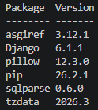
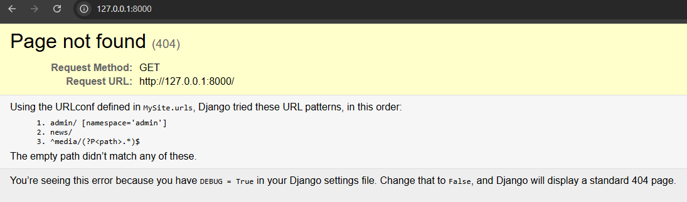

# Лабораторная работа №1: Создание виртуального окружения. Контроллеры и маршруты

**Студент:** Сусло Антон Игоревич

**Группа:** ПИЖ-б-о-25-2

**Технология:** Python + Django

## Запуск готового проекта

Требуется Python 3.12 или новее. Команды выполняются в PowerShell из папки `MyProject`:

```powershell
python -m venv venv
.\venv\Scripts\python.exe -m pip install -r requirements.txt
.\venv\Scripts\python.exe MySite\manage.py runserver
```

Если окружение `venv` уже создано, первую команду можно пропустить.

Проверка результата:

* `http://127.0.0.1:8000/news/` - текст `Hello world`;
* `http://127.0.0.1:8000/news/test/` - текст `TEST`;
* `http://127.0.0.1:8000/` и несуществующий адрес - ответ 404: для корня сайта маршрут не задан.

В этой версии нет моделей и шаблонов приложения `news`; для двух учебных страниц база данных и миграции не нужны. Маршрут `/admin/` сохранён стандартным, как в отчёте. Для входа в админку потребуются стандартные миграции Django и суперпользователь - это не входит в первую работу.

## Содержание

**1. Цель работы:** настроить виртуальное окружение, создать Django-проект и приложение, разработать контроллеры и организовать маршруты.

**2. Теоретическое обоснование:**

* **Django** - веб-фреймворк для языка Python, предназначенный для разработки веб-приложений.
* **Виртуальное окружение** позволяет устанавливать библиотеки отдельно для конкретного проекта и не смешивать их с пакетами других проектов.
* **Проект Django** содержит общие настройки сайта, а **приложение Django** реализует отдельную часть его функциональности.
* **Контроллер (view)** - функция или класс, который принимает HTTP-запрос и формирует HTTP-ответ.
* **Маршрутизация** определяет, какая функция представления должна быть вызвана при обращении пользователя к определённому URL.
* Файл `urls.py` содержит список маршрутов проекта или приложения.

## 3. Выполнение работы

### 3.1. Создание виртуального окружения

В каталоге проекта было создано виртуальное окружение:

```powershell
python -m venv venv
```

Активация виртуального окружения в PowerShell:

```powershell
.\venv\Scripts\Activate.ps1
```

Проверка установленных пакетов:

```powershell
pip list
```

---

### 3.2. Установка Django

Django был установлен командой:

```powershell
pip install Django
```

После установки список пакетов был повторно проверен:

```powershell
pip list
```
**Рисунок 1: установленный Django в списке пакетов.**



---

### 3.3. Создание проекта Django

Проект `MySite` был создан командой:

```powershell
django-admin startproject MySite
```

Основные файлы проекта:

```text
MySite/
├── manage.py
└── MySite/
    ├── __init__.py
    ├── settings.py
    ├── urls.py
    ├── asgi.py
    └── wsgi.py
```

Для запуска сервера использовалась команда:

```powershell
python manage.py runserver
```

После запуска сайт доступен по адресу:

```text
http://127.0.0.1:8000/
```

**Рисунок 2: страница 404 по корневому адресу после настройки маршрутов.**



---

### 3.4. Создание приложения `news`

Приложение было создано командой:

```powershell
python manage.py startapp news
```

После этого приложение `news` было добавлено в список `INSTALLED_APPS` файла `MySite/settings.py`:

```python
INSTALLED_APPS = [
    'django.contrib.admin',
    'django.contrib.auth',
    'django.contrib.contenttypes',
    'django.contrib.sessions',
    'django.contrib.messages',
    'django.contrib.staticfiles',
    'news',
]
```

**Рисунок 3: приложение `news` в структуре проекта**


---

### 3.5. Создание контроллеров

В файле `news/views.py` были созданы две функции представления:

```python
from django.shortcuts import render
from django.http import HttpResponse


def index(request):
    print(request)
    return HttpResponse('Hello world')


def test(request):
    print(request)
    return HttpResponse('TEST')
```

Функция `index()` возвращает текст `Hello world`, а функция `test()` - текст `TEST`.

---

### 3.6. Настройка маршрутов приложения

В приложении `news` был создан файл `urls.py`:

```python
from django.urls import path
from .views import index, test

urlpatterns = [
    path('', index),
    path('test/', test),
]
```

В корневом файле `MySite/urls.py` маршруты приложения были подключены через функцию `include()`:

```python
from django.contrib import admin
from django.urls import path, include

urlpatterns = [
    path('admin/', admin.site.urls),
    path('news/', include('news.urls')),
]
```

В результате были доступны следующие адреса:

```text
http://127.0.0.1:8000/news/
http://127.0.0.1:8000/news/test/
```

**Рисунок 4: страница `/news/` с текстом `Hello world`.**


**Рисунок 5: страница `/news/test/` с текстом `TEST`.**


---

## 4. Выводы

В ходе лабораторной работы было создано и активировано виртуальное окружение, установлен Django, создан проект `MySite` и приложение `news`. Были разработаны функции представления, настроены маршруты проекта и приложения, а также проверена обработка существующих и несуществующих URL. В результате была изучена базовая структура Django-проекта и принцип связи URL-маршрута с контроллером.

---

## 5. Использованные источники

1. **Django - официальная документация:** https://docs.djangoproject.com/
2. **Python - официальная документация:** https://docs.python.org/
