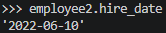
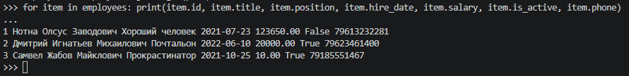
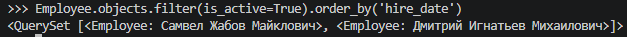

# Лабораторная работа №2: Модели. CRUD

**Студент:** Сусло Антон Игоревич

**Группа:** ПИЖ-б-о-25-2

**Вариант:** 7

**Технология:** Python + Django + SQLite

## Запуск готового проекта

Версия для лабораторной работы №2, вариант 7 «Сотрудники». Первая работа сохранена отдельно: [lab1-final](https://github.com/Sobo33/web_lab1-2/tree/lab1-final).

Требуется Python 3.12 или новее. Команды выполняются в PowerShell из папки `MyProject`:

```powershell
python -m venv venv
.\venv\Scripts\python.exe -m pip install -r requirements.txt
.\venv\Scripts\python.exe MySite\manage.py migrate
.\venv\Scripts\python.exe MySite\manage.py loaddata lab2_data
.\venv\Scripts\python.exe MySite\manage.py runserver
```

Если окружение `venv` уже создано, первую команду можно пропустить. Файл `lab2_data.json` содержит пять новостей и трёх сотрудников из исходной учебной базы. Команда `loaddata` восстанавливает эти записи по их ID; повторный запуск заменит изменения в этих записях.

Во второй работе операции с базой выполняются через Django Shell. Страницы первой работы остаются доступными: `/news/` возвращает `Hello world`, `/news/test/` - `TEST`. Вывод списка новостей через HTML-шаблон относится к следующей работе.

Для проверки индивидуального задания запусти консоль:

```powershell
.\venv\Scripts\python.exe MySite\manage.py shell
```

```python
from news.models import Employee

employees = Employee.objects.filter(is_active=True).order_by('hire_date')
list(employees.values_list('full_name', 'hire_date'))
```

В учебных данных сначала выводится Самвел Жабов Майклович (25.10.2021), затем Дмитрий Игнатьев Михаилович (10.06.2022). Неактивный сотрудник в выборку не попадает.

Ниже приведён ход выполнения работы. Команды `python manage.py ...` выполняются из папки `MySite` с активированным виртуальным окружением. После загрузки учебных данных повторять первоначальное создание записей из отчёта не требуется.

## Содержание

**1. Цель работы:** разработать модели Django, научиться выполнять миграции, работать с базой данных и выполнять CRUD-операции средствами Django ORM.

**2. Теоретическое обоснование:**

* **Модель Django** - Python-класс, описывающий структуру данных. Обычно одной модели соответствует одна таблица базы данных.
* Все модели Django наследуются от `django.db.models.Model`.
* **ORM (Object-Relational Mapping)** позволяет работать с базой данных через Python-код без необходимости вручную писать SQL-запросы.
* **Миграции** позволяют переносить изменения моделей в структуру базы данных.
* **CRUD** включает четыре основные операции:
  * Create - создание записи;
  * Read - чтение записей;
  * Update - изменение записи;
  * Delete - удаление записи.
* В проекте используется база данных **SQLite**, которая хранится в файле `db.sqlite3`.

## 3. Создание модели `News`

В файле `news/models.py` была создана модель:

```python
from django.db import models


class News(models.Model):
    title = models.CharField(max_length=150)
    content = models.TextField(blank=True)
    created_at = models.DateTimeField(auto_now_add=True)
    updated_at = models.DateTimeField(auto_now=True)
    photo = models.ImageField(upload_to='photos/%Y/%m/%d')
    is_published = models.BooleanField(default=True)

    def __str__(self):
        return self.title
```

Назначение полей:

* `title` - название новости;
* `content` - содержимое новости;
* `created_at` - дата и время создания;
* `updated_at` - дата и время последнего изменения;
* `photo` - изображение;
* `is_published` - признак публикации;
* `id` создаётся Django автоматически и используется как первичный ключ.

Для работы `ImageField` была установлена библиотека Pillow:

```powershell
pip install Pillow
```

**Рисунок 1: модель `News` в файле `models.py`.**


---

## 4. Создание и применение миграций

Для создания файла миграции была выполнена команда:

```powershell
python manage.py makemigrations
```

Для просмотра SQL-запроса миграции:

```powershell
python manage.py sqlmigrate news 0001
```

Для применения миграции к базе данных:

```powershell
python manage.py migrate
```

После выполнения миграции в базе данных была создана таблица для модели `News`.

**Рисунок 2: результат команды `makemigrations`.**


**Рисунок 3: результат команды `migrate`.**


---

## 5. Настройка медиафайлов

В конце `MySite/settings.py` были добавлены настройки:

```python
MEDIA_ROOT = BASE_DIR / 'media'
MEDIA_URL = '/media/'
```

В `MySite/urls.py` была добавлена настройка маршрута для медиафайлов в режиме разработки:

```python
from django.contrib import admin
from django.urls import path, include
from django.conf import settings
from django.conf.urls.static import static

urlpatterns = [
    path('admin/', admin.site.urls),
    path('news/', include('news.urls')),
]

if settings.DEBUG:
    urlpatterns += static(
        settings.MEDIA_URL,
        document_root=settings.MEDIA_ROOT
    )
```

`MEDIA_ROOT` определяет каталог хранения загруженных файлов, а `MEDIA_URL` - URL-префикс для доступа к ним.

---

## 6. Работа с Django Shell и CRUD

Для работы с базой данных через ORM была запущена консоль Django:

```powershell
python manage.py shell
```

Импорт модели:

```python
from news.models import News
```

### 6.1. Create - создание записей

Первый способ:

```python
news1 = News(
    title='Новость 1',
    content='Контент новости 1'
)

news1.save()
```

Второй способ:

```python
news2 = News()
news2.title = 'Новость 2'
news2.content = 'Контент новости 2'
news2.save()
```

Третий способ:

```python
news3 = News.objects.create(
    title='Новость 3',
    content='Контент новости 3'
)
```

**Рисунок 4: создание записей через Django Shell.**



---

### 6.2. Read - чтение записей

Получение всех новостей:

```python
News.objects.all()
```

Сохранение QuerySet в переменную:

```python
news = News.objects.all()

for item in news:
    print(item.title, item.is_published)
```

Фильтрация записей:

```python
News.objects.filter(title='Новость 6')
```

Получение одной конкретной записи по первичному ключу:

```python
news1 = News.objects.get(pk=1)
```

Исключение записей по условию:

```python
News.objects.exclude(title='Новость 6')
```

---

### 6.3. Update - изменение записи

```python
news1 = News.objects.get(pk=1)
news1.title = 'Изменённая новость'
news1.save()
```

Проверка:

```python
News.objects.get(pk=1).title
```

---

### 6.4. Delete - удаление записи

Для проверки удаления была создана временная запись:

```python
temp = News.objects.create(
    title='Test',
    content='Test'
)
```

Удаление:

```python
temp.delete()
```

Проверка содержимого таблицы:

```python
News.objects.all()
```

---

# 7. Индивидуальное задание. Вариант 7 - Сотрудники

По варианту необходимо создать модель `Employee` со следующими полями:

* `full_name`;
* `position`;
* `hire_date`;
* `salary`;
* `is_active`.

Также необходимо добавить поле `phone` и вывести всех активных сотрудников, отсортированных по дате приёма.

## 7.1. Создание модели `Employee`

В файл `news/models.py` была добавлена модель:

```python
class Employee(models.Model):
    full_name = models.CharField(max_length=150)
    position = models.CharField(max_length=100)
    hire_date = models.DateField()
    salary = models.DecimalField(max_digits=10, decimal_places=2)
    is_active = models.BooleanField(default=True)
    phone = models.CharField(max_length=20)

    def __str__(self):
        return self.full_name
```

После изменения модели были созданы и применены миграции:

```powershell
python manage.py makemigrations
python manage.py migrate
```

В исходном коде поле имени сотрудника называлось `title`, хотя в задании и отчёте указано `full_name`. В итоговой версии добавлена миграция `0003_rename_employee_title`, которая переименовывает поле и сохраняет существующие записи. Первые две миграции оставлены для совместимости с исходной учебной базой. Скриншоты ниже показывают первоначальный ход выполнения работы, до этого исправления.

---

## 7.2. Добавление сотрудников

В Django Shell модель была импортирована:

```python
from news.models import Employee
```

Созданы несколько записей:

```python
Employee.objects.create(
    full_name='Нотна Олсус Заводович',
    position='Хороший человек',
    hire_date='2021-07-23',
    salary=123650,
    is_active=False,
    phone='+79613232281'
)

Employee.objects.create(
    full_name='Дмитрий Игнатьев Михаилович',
    position='Почтальон',
    hire_date='2022-06-10',
    salary=20000,
    is_active=True,
    phone='+79623461400'
)

Employee.objects.create(
    full_name='Самвел Жабов Майклович',
    position='Прокрастинатор',
    hire_date='2021-10-25',
    salary=10,
    is_active=True,
    phone='+79185551467'
)
```

Проверка записей:

```python
Employee.objects.all()
```

Для удобства отдельные записи можно получить по первичному ключу:

```python
employee1 = Employee.objects.get(pk=1)
employee2 = Employee.objects.get(pk=2)
employee3 = Employee.objects.get(pk=3)
```

**Рисунок 5: созданные сотрудники и их ID.**



---

## 7.3. Вывод активных сотрудников по дате приёма

Основное условие варианта выполнено запросом:

```python
employees = Employee.objects.filter(
    is_active=True
).order_by('hire_date')
```

**Рисунок 6: результат выборки активных сотрудников, отсортированных по дате приёма.**



---

# 8. Ответы на контрольные вопросы

### 1. Что такое модель в Django и для чего она используется?

Модель в Django - это Python-класс, который описывает структуру данных приложения. Обычно каждой модели соответствует отдельная таблица базы данных, а полям модели - столбцы этой таблицы. Модели используются для создания, чтения, изменения и удаления данных.

### 2. Какие типы полей вы знаете? Приведите примеры.

Основные типы полей Django:

* `CharField` - строка ограниченной длины;
* `TextField` - большой текст;
* `IntegerField` - целое число;
* `DecimalField` - десятичное число;
* `BooleanField` - логическое значение `True` или `False`;
* `DateField` - дата;
* `DateTimeField` - дата и время;
* `ImageField` - изображение.

Пример:

```python
name = models.CharField(max_length=100)
salary = models.DecimalField(max_digits=10, decimal_places=2)
is_active = models.BooleanField(default=True)
```

### 3. Чем отличаются параметры `blank=True` и `null=True`?

`blank=True` означает, что поле разрешается оставить пустым при проверке данных в формах Django.

`null=True` означает, что в базе данных для этого поля разрешено хранить значение `NULL`.

### 4. Что такое миграции и зачем они нужны? Опишите основные команды для работы с ними.

Миграции - механизм Django для переноса изменений моделей в структуру базы данных.

Основные команды:

```powershell
python manage.py makemigrations
```

Создаёт файлы миграций.

```powershell
python manage.py migrate
```

Применяет миграции к базе данных.

```powershell
python manage.py sqlmigrate news 0001
```

Показывает SQL-запросы, соответствующие выбранной миграции.

### 5. Как создать суперпользователя для доступа к административной панели Django?

Используется команда:

```powershell
python manage.py createsuperuser
```

После этого необходимо указать имя пользователя, при необходимости электронную почту и пароль. Затем можно войти в административную панель через `/admin/`.

### 6. Что такое ORM? Перечислите основные методы для выполнения операций CRUD.

ORM - Object-Relational Mapping - механизм, который позволяет взаимодействовать с базой данных с помощью объектов и методов Python.

Основные операции:

```python
# Create
News.objects.create(...)
obj.save()

# Read
News.objects.all()
News.objects.filter(...)
News.objects.get(...)
News.objects.exclude(...)

# Update
obj.title = 'Новое значение'
obj.save()

# Delete
obj.delete()
```

### 7. В чём разница между методами `filter()` и `get()`?

`filter()` возвращает `QuerySet`, который может содержать ноль, одну или несколько записей.

`get()` предназначен для получения ровно одной записи. Если запись не найдена или найдено несколько записей, Django выдаст исключение.

### 8. Как настроить загрузку изображений (медиафайлов) в проекте Django?

В `settings.py` задаются:

```python
MEDIA_ROOT = BASE_DIR / 'media'
MEDIA_URL = '/media/'
```

В корневом `urls.py` в режиме разработки добавляется:

```python
if settings.DEBUG:
    urlpatterns += static(
        settings.MEDIA_URL,
        document_root=settings.MEDIA_ROOT
    )
```

Для использования `ImageField` также необходима библиотека Pillow.

### 9. Для чего нужен метод `__str__` в модели?

Метод `__str__()` определяет удобное текстовое представление объекта модели.

Например:

```python
def __str__(self):
    return self.title
```

После этого вместо малоинформативного вида объекта Django может отображать название новости.

### 10. Что произойдёт, если выполнить `python manage.py makemigrations`, но не выполнить `migrate`?

Команда `makemigrations` только создаст файл с описанием изменений модели. Структура реальной базы данных при этом не изменится. Чтобы изменения были применены к базе данных, необходимо выполнить:

```powershell
python manage.py migrate
```

---

# 9. Выводы

В ходе лабораторной работы были изучены модели Django, миграции и работа с базой данных SQLite через Django ORM. Была создана модель `News`, выполнена настройка медиафайлов и рассмотрены операции Create, Read, Update и Delete. Также были изучены методы `all()`, `filter()`, `get()` и `exclude()`.

В рамках индивидуального задания варианта 7 была создана модель `Employee`, добавлено поле `phone`, выполнены миграции и заполнена база данных. С помощью ORM была сформирована выборка активных сотрудников с сортировкой по дате приёма.

---

# 10. Использованные источники

1. **Django - официальная документация:** https://docs.djangoproject.com/
2. **Django Models:** https://docs.djangoproject.com/en/stable/topics/db/models/
3. **Django QuerySet API:** https://docs.djangoproject.com/en/stable/ref/models/querysets/
4. **Python - официальная документация:** https://docs.python.org/
