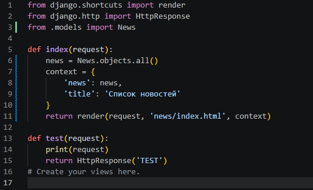
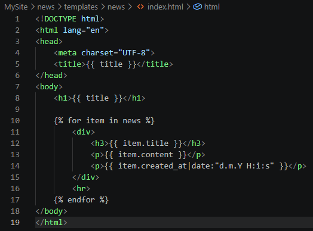
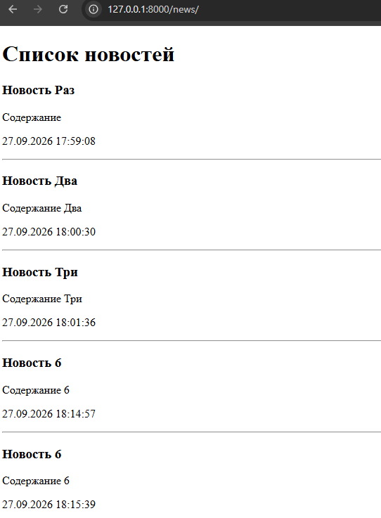
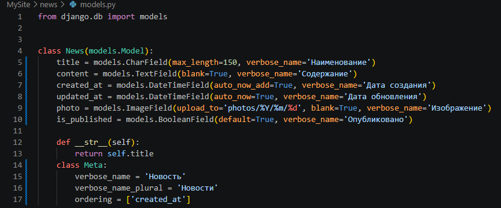
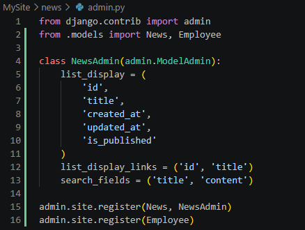
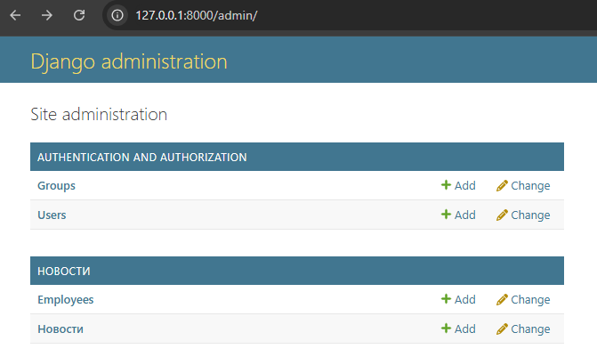
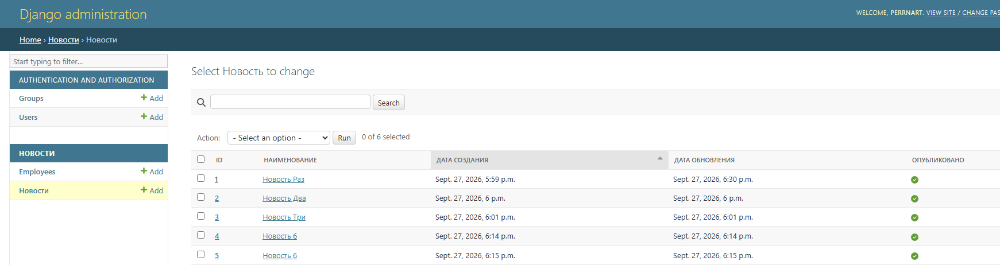
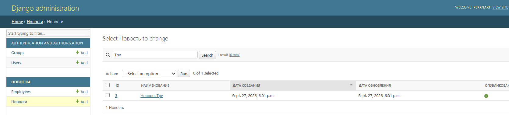
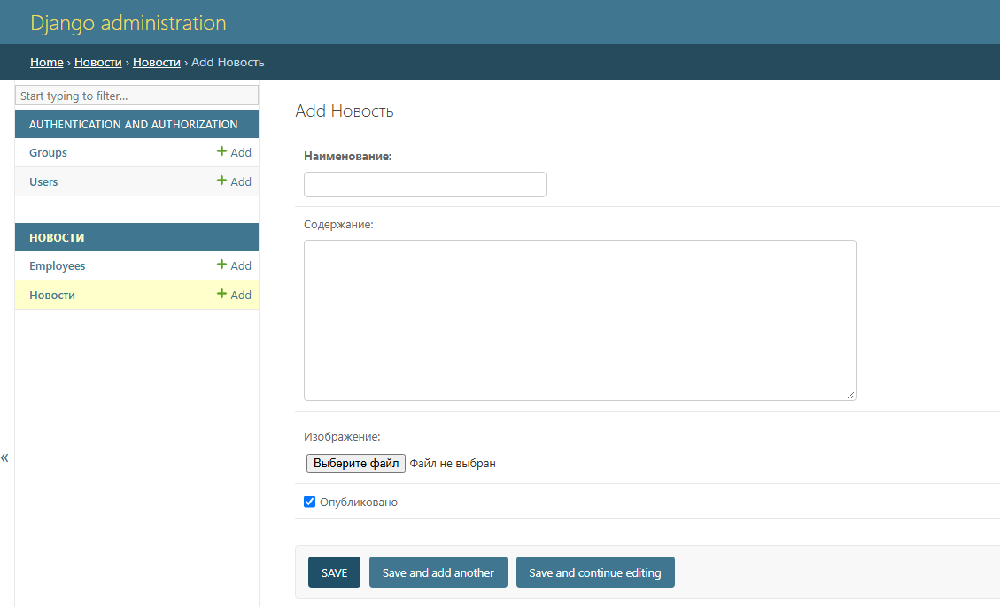

# Лабораторная работа №3: Шаблоны. Админка Django

**Студент:** Сусло Антон Игоревич

**Группа:** ПИЖ-б-о-25-2

**Технология:** Python + Django + SQLite

<!--
Оформление скриншотов:
1. Сохрани изображения в папку scr3 рядом с этим README.md.
2. Для каждого рисунка ниже указаны имя файла и необходимое содержимое.
3. После добавления изображения убери строку с местом для скриншота
   и маркеры HTML-комментария вокруг соответствующей строки .
-->

## Содержание

**1. Цель работы:** изучить шаблоны Django, организовать вывод данных модели на HTML-страницу, настроить административную панель и управление новостями.

**2. Теоретическое обоснование:**

- **Шаблон** - HTML-файл с переменными, тегами и фильтрами шаблонизатора Django.
- **Контекст** - словарь данных, передаваемых из контроллера в шаблон.
- **Рендеринг** - формирование готовой HTML-страницы на основе шаблона и контекста.
- **Переменные шаблона** записываются в двойных фигурных скобках, например `{{ title }}`.
- **Теги шаблона** управляют выводом данных. Например, `` позволяет перебрать записи.
- **Фильтры** изменяют представление значения перед выводом. В работе используется фильтр `date`.
- **Административная панель Django** предоставляет интерфейс для работы с зарегистрированными моделями.
- **ModelAdmin** позволяет настроить столбцы списка, ссылки на редактирование и поиск.

## 3. Выполнение работы

### 3.1. Получение новостей и передача контекста

В файле `news/views.py` была импортирована модель `News`. Контроллер `index()` был изменён: он получает записи из базы данных и передаёт их в шаблон.

```python
from django.shortcuts import render
from django.http import HttpResponse
from .models import News


def index(request):
    news = News.objects.all()
    context = {
        'news': news,
        'title': 'Список новостей'
    }
    return render(request, 'news/index.html', context)
```

Метод `News.objects.all()` получает все новости. В словаре `context` передаются два значения:

- `news` - набор записей для вывода;
- `title` - заголовок страницы.

Функция `render()` принимает HTTP-запрос, путь к шаблону и контекст. Она формирует HTML-ответ для браузера.

**Рисунок 1: контроллер `index()` и передача контекста.**

> **Место для скриншота 1.** Открыть `news/views.py` в редакторе и показать импорт `News`, получение записей, словарь `context` и вызов `render()`. Имя файла: `scr3/01_view.png`.

<!--  -->

---

### 3.2. Создание HTML-шаблона

В приложении была создана папка `templates`, а внутри неё папка `news`. Вложенная папка `news` позволяет различать шаблоны приложений с одинаковыми именами файлов.

В файл `news/templates/news/index.html` был добавлен следующий код:

```html
<!DOCTYPE html>
<html lang="en">
<head>
    <meta charset="UTF-8">
    <title>{{ title }}</title>
</head>
<body>
    <h1>{{ title }}</h1>

    
        <div>
            <h3>{{ item.title }}</h3>
            <p>{{ item.content }}</p>
            <p>{{ item.created_at|date:"d.m.Y H:i:s" }}</p>
        </div>
        <hr>
    
</body>
</html>
```

Переменная `title` используется в названии вкладки браузера и заголовке страницы. Цикл `` выводит для каждой новости её название, содержание и дату создания. Тег `<hr>` визуально разделяет записи.

**Рисунок 2: расположение и содержимое HTML-шаблона.**

> **Место для скриншота 2.** Показать в редакторе дерево `news/templates/news/index.html` и код шаблона с циклом ``. Имя файла: `scr3/02_template.png`.

<!--  -->

---

### 3.3. Форматирование даты и проверка страницы

Для отображения даты создания новости был применён фильтр:

```django
{{ item.created_at|date:"d.m.Y H:i:s" }}
```

В результате дата выводится в виде `день.месяц.год часы:минуты:секунды`. Формат задаётся непосредственно в шаблоне. В текущих настройках проекта сохранены `LANGUAGE_CODE = 'en-us'` и `TIME_ZONE = 'UTC'`.

После открытия `/news/` формируется страница с заголовком «Список новостей» и записями из базы данных. В этой реализации выводятся все новости, полученные методом `all()`.

**Рисунок 3: страница со списком новостей и отформатированными датами.**

> **Место для скриншота 3.** Открыть `http://127.0.0.1:8000/news/` и показать заголовок страницы, несколько новостей и даты их создания. Имя файла: `scr3/03_news_page.png`.

<!--  -->

---

### 3.4. Настройка модели `News`

В модели были заданы русские подписи полей через `verbose_name`. Также добавлен внутренний класс `Meta` с названиями модели и порядком сортировки.

```python
class News(models.Model):
    title = models.CharField(max_length=150, verbose_name='Наименование')
    content = models.TextField(blank=True, verbose_name='Содержание')
    created_at = models.DateTimeField(auto_now_add=True, verbose_name='Дата создания')
    updated_at = models.DateTimeField(auto_now=True, verbose_name='Дата обновления')
    photo = models.ImageField(upload_to='photos/%Y/%m/%d', blank=True, verbose_name='Изображение')
    is_published = models.BooleanField(default=True, verbose_name='Опубликовано')

    def __str__(self):
        return self.title

    class Meta:
        verbose_name = 'Новость'
        verbose_name_plural = 'Новости'
        ordering = ['created_at']
```

Назначение настроек:

- `verbose_name` у поля задаёт его подпись в административной форме;
- `Meta.verbose_name` задаёт название модели в единственном числе;
- `Meta.verbose_name_plural` задаёт название модели во множественном числе;
- `Meta.ordering` задаёт сортировку записей по умолчанию;
- `__str__()` возвращает название новости для её текстового представления.

В проекте используется `ordering = ['created_at']`: новости располагаются по возрастанию даты создания, от более ранних к более поздним. Эта настройка действует и при вызове `News.objects.all()`, поэтому отдельный `order_by()` в контроллере не требуется.

**Рисунок 4: подписи полей и настройки `Meta` модели `News`.**

> **Место для скриншота 4.** Показать класс `News` в `news/models.py`: подписи полей, `blank=True` у изображения, метод `__str__()` и класс `Meta`. Имя файла: `scr3/04_news_model.png`.

<!--  -->

---

### 3.5. Подключение моделей к административной панели

Для доступа к административной панели в проекте создан суперпользователь. Для создания такой учётной записи используется команда:

```powershell
python manage.py createsuperuser
```

После ввода имени пользователя и пароля вход выполняется по адресу `/admin/`.

В `news/admin.py` были импортированы модели `News` и `Employee`. Для модели `News` создан класс настройки `NewsAdmin`:

```python
from django.contrib import admin
from .models import News, Employee


class NewsAdmin(admin.ModelAdmin):
    list_display = (
        'id',
        'title',
        'created_at',
        'updated_at',
        'is_published'
    )
    list_display_links = ('id', 'title')
    search_fields = ('title', 'content')


admin.site.register(News, NewsAdmin)
admin.site.register(Employee)
```

Модель `News` зарегистрирована вместе с классом `NewsAdmin`. Модель `Employee`, созданная во второй работе, зарегистрирована со стандартными настройками.

**Рисунок 5: регистрация моделей и настройка `NewsAdmin`.**

> **Место для скриншота 5.** Открыть `news/admin.py` и показать класс `NewsAdmin` и обе команды `admin.site.register()`. Имя файла: `scr3/05_admin_code.png`.

<!--  -->

---

### 3.6. Название приложения в админке

Для изменения названия приложения в `news/apps.py` была добавлена настройка `verbose_name`:

```python
from django.apps import AppConfig


class NewsConfig(AppConfig):
    name = 'news'
    verbose_name = 'Новости'
```

Приложение отображается под названием «Новости». Название модели в списке также определяется её настройкой `verbose_name_plural = 'Новости'`.

**Рисунок 6: приложение и зарегистрированные модели в админке.**

> **Место для скриншота 6.** После входа открыть `http://127.0.0.1:8000/admin/` и показать раздел приложения «Новости» с моделями новостей и сотрудников. Имя файла: `scr3/06_admin_index.png`.

<!--  -->

---

### 3.7. Настройка списка новостей и ссылок

В `NewsAdmin` параметр `list_display` определяет столбцы списка:

- идентификатор;
- наименование;
- дата создания;
- дата обновления;
- признак публикации.

Подписи столбцов берутся из описания полей модели. Значение `is_published` отображается как логический признак.

Настройка `list_display_links = ('id', 'title')` делает идентификатор и наименование ссылками на форму редактирования записи.

**Рисунок 7: настроенный список новостей в админке.**

> **Место для скриншота 7.** Открыть `http://127.0.0.1:8000/admin/news/news/` и показать столбцы списка, ссылки на новости и признак публикации. Имя файла: `scr3/07_admin_list.png`.

<!--  -->

---

### 3.8. Поиск по новостям

Для поиска используется настройка:

```python
search_fields = ('title', 'content')
```

Она добавляет строку поиска в список новостей. Поиск выполняется по наименованию и содержанию записи.

**Рисунок 8: поиск новостей в административной панели.**

> **Место для скриншота 8.** Ввести в строку поиска часть названия или содержания существующей новости и показать запрос вместе с результатами. Имя файла: `scr3/08_admin_search.png`.

<!--  -->

---

### 3.9. Работа с формой новости и изображениями

Административная панель предоставляет форму добавления и редактирования новости. В ней доступны наименование, содержание, изображение и признак публикации.

Для хранения изображений используются настройки проекта:

```python
MEDIA_ROOT = BASE_DIR / 'media'
MEDIA_URL = '/media/'
```

Параметр `upload_to='photos/%Y/%m/%d'` задаёт размещение загруженных файлов по подпапкам года, месяца и дня внутри `media`.

Изначально поле изображения было обязательным в форме. В итоговом варианте для него указан `blank=True`:

```python
photo = models.ImageField(
    upload_to='photos/%Y/%m/%d',
    blank=True,
    verbose_name='Изображение'
)
```

Теперь форму можно заполнить без изображения. Параметр `blank=True`. В текущем шаблоне пользовательской страницы выводятся название, содержание и дата новости. Поле изображения хранится в модели и доступно в административной форме.

**Рисунок 9: форма новости с необязательным изображением.**

> **Место для скриншота 9.** Открыть форму добавления или редактирования новости и показать подписи полей и поле «Изображение». Для демонстрации необязательного изображения можно заполнить наименование, оставить изображение пустым и сохранить запись. Имя файла: `scr3/09_news_form.png`.

<!--  -->

## 4. Выводы

В ходе лабораторной работы был создан HTML-шаблон для вывода новостей из базы данных. В контроллере организована передача контекста, а в шаблоне использованы переменные, цикл `for` и фильтр `date`.

Была настроена административная панель: зарегистрированы модели `News` и `Employee`, заданы подписи полей и название приложения, настроены столбцы списка, ссылки на редактирование и поиск новостей. Для модели `News` определён порядок сортировки по дате создания, а поле изображения сделано необязательным. Изменения отражены в миграциях и применены к базе данных.

В результате изучена связь модели, контроллера и шаблона, а также основные способы настройки административного интерфейса Django.

## 5. Использованные источники

1. [Django: шаблоны](https://docs.djangoproject.com/en/6.1/topics/templates/).
2. [Django: встроенные теги и фильтры, фильтр date](https://docs.djangoproject.com/en/6.1/ref/templates/builtins/#date).
3. [Django: административная панель](https://docs.djangoproject.com/en/6.1/ref/contrib/admin/).
